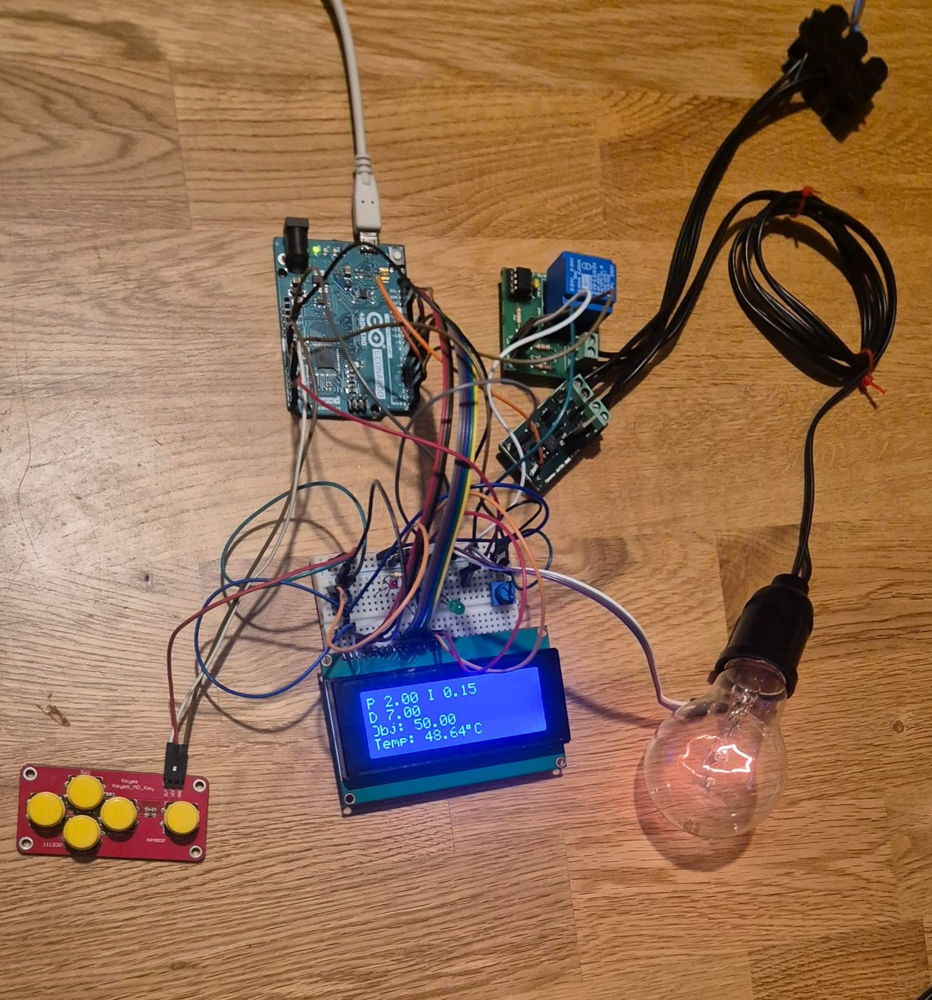
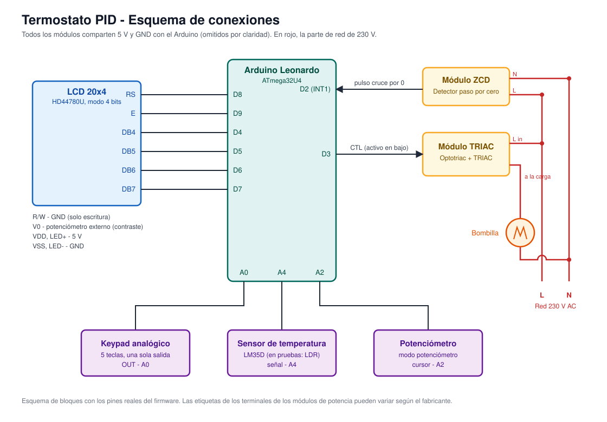

# Termostato PID con Arduino Leonardo

Controlador de temperatura con **regulación PID**, **control de potencia por ángulo de fase** (TRIAC + detector de paso por cero) e interfaz con **LCD 20×4 y teclado analógico**. Todo el firmware de bajo nivel (LCD, teclado, ADC y timers) está escrito **sin librerías externas**, accediendo directamente a los registros del ATmega32U4. La única dependencia es `PID_v1`.

> **Aviso de seguridad.** Este proyecto conmuta **tensión de red (230 V AC)**. Si lo replicas, usa optoaislamiento, aísla bien la parte de potencia, no toques el circuito conectado a la red y no lo dejes sin supervisión. Úsalo bajo tu propia responsabilidad.



*Montaje en funcionamiento: modo termostato con Kp = 2, Ki = 0,15, Kd = 7 y objetivo de 50 °C.*

---

## Características

- **5 modos de funcionamiento**: Encendido (100 %), Apagado, Control manual (% por teclado), Termostato (PID) y Potenciómetro.
- **Control por ángulo de fase**: ZCD en `INT1` + Timer1 en modo CTC para disparar el TRIAC en el instante adecuado de cada semiciclo.
- **PID configurable en caliente** desde el menú (Kp, Ki, Kd) sin reflashear.
- **Resolución ≥ 0,25 °C**: sobremuestreo de 16 muestras (10 → ~12 bits) + filtro EMA (α = 0,2).
- **LCD HD44780 en modo 4 bits** y **teclado analógico** con antirrebote no bloqueante y autorrepetición acelerada.
- **Registro por puerto serie en CSV** para analizar la respuesta del sistema.

## Hardware

| Componente | Detalle |
|---|---|
| Microcontrolador | Arduino Leonardo (ATmega32U4) |
| Pantalla | LCD 20×4 con HD44780U |
| Entrada de usuario | Keypad analógico de 5 teclas |
| Sensor | LM35D previsto; **LDR usada en las pruebas** (respuesta más rápida) |
| Actuador | Bombilla incandescente |
| Potencia | Optotriac + TRIAC |
| Sincronización | Detector de paso por cero (ZCD) |
| Extra | Potenciómetro (modo potenciómetro) y otro para el contraste del LCD |

### Conexiones

| Función | Pin Arduino |
|---|---|
| LCD RS | 8 |
| LCD E | 9 |
| LCD D4 – D7 | 4, 5, 6, 7 |
| LCD R/W | GND (solo escritura) |
| Control TRIAC (CTL) | 3 *(activo en bajo)* |
| Salida ZCD | 2 (`INT1`) |
| Teclado | A0 |
| Sensor de temperatura / LDR | A4 |
| Potenciómetro | A2 |

El contraste del LCD (V0) se ajusta con un potenciómetro externo. Se omiten las conexiones de 5 V y GND.



## Estructura del proyecto

```
termostato/
├── termostato.ino   # setup(), ISRs (ZCD y Timer1), variables globales y PID
├── menu.ino         # Menús paginados y navegación
├── bombilla.ino     # Modos de funcionamiento, lectura de temperatura (oversampling + EMA)
├── timer_pwm.ino    # Control PID, ajuste de parámetros y log CSV
├── teclado.ino      # Lectura del keypad, antirrebote y ADC propio (anal_digit)
├── lcd.ino          # Driver HD44780 en 4 bits sin librerías
└── csv/             # Datos y gráficas de las pruebas de sintonización
docs/
├── montaje.jpg      # Foto del montaje
└── esquema.svg      # Esquema de conexiones
```

## Instalación

1. Instala el [Arduino IDE](https://www.arduino.cc/en/software).
2. Instala la librería **PID** de Brett Beauregard (`PID_v1`) desde *Herramientas → Administrar bibliotecas*.
3. Abre la carpeta `termostato/` (el nombre de la carpeta debe coincidir con `termostato.ino`; el IDE cargará el resto de archivos como pestañas).
4. Selecciona la placa **Arduino Leonardo** y el puerto, y sube el sketch.

## Uso

| Tecla | Acción |
|---|---|
| 2 | Arriba / incrementar valor |
| 3 | Abajo / decrementar valor |
| 5 | OK / confirmar |
| 1 | Volver / salir del modo actual |

Mantener pulsada una tecla acelera la repetición, útil para ajustar potencia o constantes PID.

| Modo | Descripción |
|---|---|
| **Encendido** | Carga al 100 % y muestra la temperatura. |
| **Apagado** | TRIAC desconectado; sigue mostrando la temperatura. |
| **CTL Manual** | Fijas un % de potencia con el teclado. El PID queda deshabilitado. |
| **Termostato** | Fijas la temperatura objetivo y el PID regula la potencia. Submenú: *Termostato / Parámetros / Reset / Menú*. |
| **Potenciómetro** | La potencia sigue en continuo la posición del potenciómetro (A2). |

**Parámetros PID:** `Kp` velocidad de reacción · `Ki` corrección acumulada · `Kd` amortiguación. *Reset* pone Kp, Ki y Kd a cero.

## Cómo funciona

### Control de potencia por fase

1. El ZCD dispara `INT1` en cada cruce por cero de la red.
2. `ISR(INT1_vect)` reinicia Timer1 y calcula el retardo según el % de potencia pedido.
3. Timer1 (CTC, prescaler 8) lanza `ISR(TIMER1_COMPA_vect)` al llegar a `OCR1A`.
4. Esa ISR genera un pulso corto sobre el optotriac, que dispara el TRIAC durante el resto del semiciclo.

A menor retardo, mayor energía entregada a la carga.

### Medida de temperatura

```
16 muestras ADC → suma → /4 (≈12 bits) → T = ADC · 5/4095 · 100 → EMA: T = 0.8·T_ant + 0.2·T_nueva
```

> En las pruebas se usó una **LDR** como sustituto rápido del LM35, por lo que el valor mostrado es una *temperatura simulada*, no una medida térmica calibrada.

### PID

Se usa `PID_v1` con salida limitada a 0–100 % (se traduce directamente a potencia) y periodo de muestreo de 1 s.

## Sintonización PID

Respuesta a un escalón de 50 °C durante 300 s. Los datos crudos y las gráficas están en [`termostato/csv/`](termostato/csv).

| Kp | Ki | Kd | Sobreoscilación | T. subida | Error est. |
|---:|---:|---:|---:|---:|---:|
| 2 | 0 | 0 | 8,24 % | 267 s | −3,60 °C |
| 2 | 0,05 | 0 | 14,94 % | 33 s | −0,38 °C |
| 2 | 0,03 | 10 | 13,72 % | 34 s | +0,25 °C |
| 2 | 0,03 | 8 | 13,92 % | 24 s | −0,04 °C |
| **2** | **0,15** | **7** | 18,94 % | 22 s | **+0,04 °C** |
| 2 | 0,28 | 9 | 23,08 % | 22 s | +0,47 °C |

Con **Kp = 2, Ki = 0,15, Kd = 7** el sistema cumple el requisito de ±1 °C en régimen permanente, a costa de un sobreimpulso inicial notable.


### Registrar datos por serie

La función `pid_pr_log()` imprime una línea CSV por segundo a 9600 baudios:

```
tiempo_ms,temp_real,temp_objetivo,salida_pid
```

Puedes capturarla con el monitor serie, `screen`, `pyserial`, etc.

## Posibles mejoras

- [ ] Sustituir la LDR por el LM35 (o un NTC/termopar) y calibrar.
- [ ] Guardar Kp/Ki/Kd en EEPROM.
- [ ] Autotuning (Ziegler–Nichols o *relay feedback*).
- [ ] Menú basado en máquina de estados en lugar de llamadas anidadas.
- [ ] Salida serie/USB para monitorización en tiempo real.

## Licencia

Este proyecto se distribuye bajo la licencia MIT. Consulta el archivo [LICENSE](LICENSE) para más detalles.

## Autor

Proyecto de práctica de sistemas basados en microcontrolador. Añade aquí tu nombre y/o perfil de GitHub.
